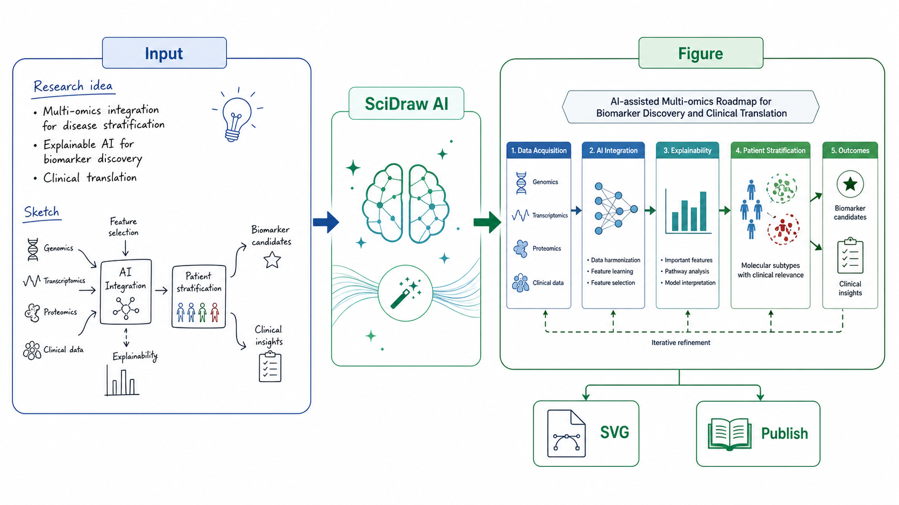
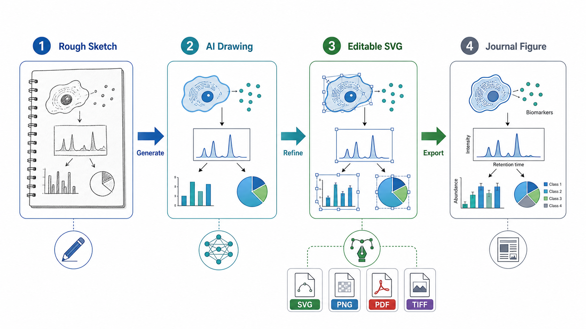
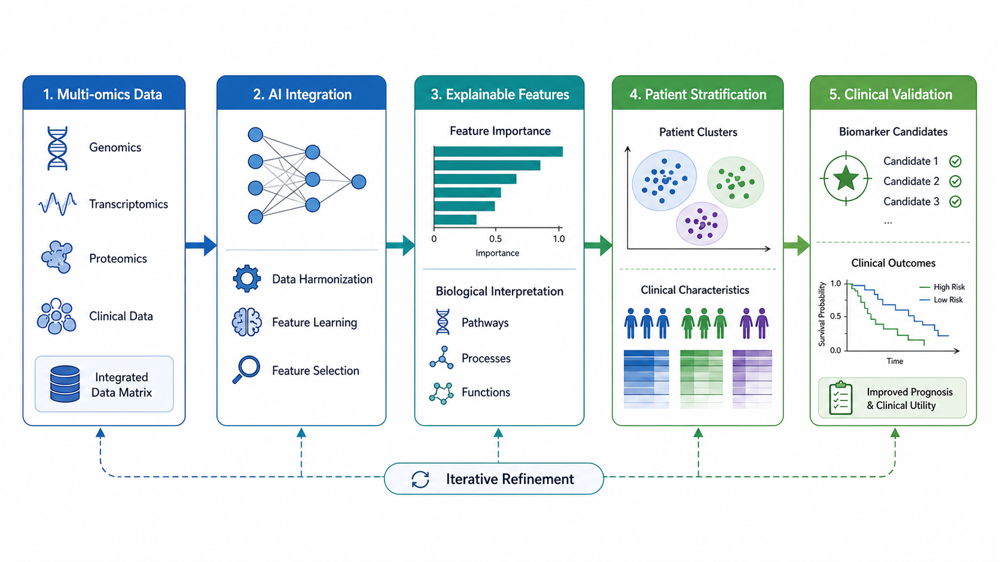
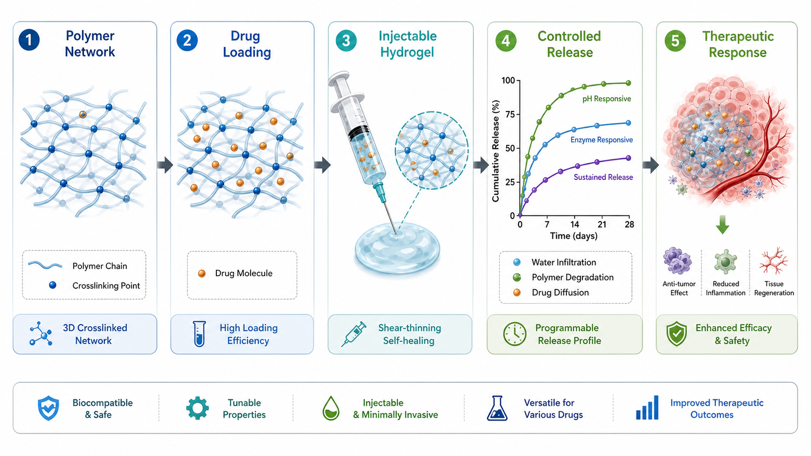
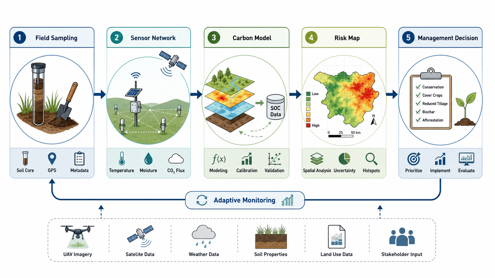

# SciDraw AI 科研画图 Skill

[](./README_en.md)
[](https://sci-draw.com/ai-drawing)
[](https://github.com/TopLocalAI/scidraw-ai-scientific-illustration-skill/stargazers)
[](https://github.com/TopLocalAI/scidraw-ai-scientific-illustration-skill/forks)

SciDraw AI 官方科研画图 Skill，可在 Codex、Claude Code、OpenClaw、Hermes Agent 等支持 `SKILL.md` 的 Agent 中使用。它把研究想法、论文方法、基金路线、实验流程或模型结构转换成清晰的科研图，并支持调用 SciDraw AI 官方 API。

> [!TIP]
> 你可以直接使用 [SciDraw AI](https://sci-draw.com/ai-drawing) 网页版，也可以配置官方 API 后通过内置 Python 客户端生成：
>
> - [AI Drawing 主入口](https://sci-draw.com/ai-drawing)
> - [SciDraw AI 官网](https://sci-draw.com/)
> - [创建 API Key](https://sci-draw.com/settings/api-keys)
> - [API 文档](https://sci-draw.com/docs/api)
> - [图片转 SVG/PPTX/PDF/TIFF 等转换工具](https://sci-draw.com/convert)
>
> SciDraw AI 平台支持 AI Drawing、草图转专业图、图片编辑、SVG/PPTX 可编辑导出、PNG/PDF/TIFF 出版级导出等能力；本 skill 覆盖 agent 里的科研图生成与提示词整理流程。

## 温馨提示

这是 SciDraw AI 的官方 Agent 入口。推荐先接入 [SciDraw AI MCP 服务](https://sci-draw.com/mcp)：用 SciDraw AI 账号登录即可，无需 API Key；Skill 检测到 MCP 工具时会直接用它画图。没有 MCP 时，配置 `SCIDRAW_API_KEY` 后，Skill 会规划科研图、调用 SciDraw AI 官方 API、下载结果并指导检查与迭代，不会在未说明的情况下替换成其他图片服务。

需要交互编辑、SVG/PPTX 转换、批量工作流或出版格式导出时，请使用完整的 SciDraw AI 网页版。

## 特点

- 逐图迭代：默认按单幅科研图组织提示词和输出，方便确认结构、风格和标签；需要多张图时可以按图逐张生成。
- MCP 优先：已连接 SciDraw AI MCP 服务时直接调用，无需 API Key（Claude Code：`claude mcp add --transport http scidraw-ai https://sci-draw.com/api/mcp`；Codex：`codex mcp add scidraw-ai --url https://sci-draw.com/api/mcp`）。
- API 备选：直接 API 生成使用 `SCIDRAW_API_KEY` 和仅依赖 Python 标准库的客户端。
- 网页版替代入口：既没有 MCP 也没有 API key 时，使用 SciDraw AI 在线科研绘图。
- 避免后端混淆：只有用户明确要求时才改用其他图片服务。
- 科研场景友好：适合技术路线图、机制示意图、方法流程图、模型结构图、研究框架图和图文摘要草稿。
- 源图约束：当用户提供实验图、截图、坐标轴或论文原图时，可要求保留关键标签、数值、单位和结构关系。
- 平台互补：需要 SVG/PPTX 可编辑导出、PNG/PDF/TIFF 出版级导出、多轮编辑和完整项目管理时，推荐使用 SciDraw AI 网站。

## 生成效果

### 从研究想法到科研图

[](https://sci-draw.com/ai-drawing)

### 科研图示例

| 英文标签工作流 | 英文标签生物标志物路线图 |
| --- | --- |
| [](https://sci-draw.com/ai-drawing) | [](https://sci-draw.com/ai-drawing) |

| 水凝胶药物递送机制图 | 土壤碳监测工作流 |
| --- | --- |
| [](https://sci-draw.com/ai-drawing) | [](https://sci-draw.com/ai-drawing) |

## 适用场景

- 国家自然科学基金、社科基金、课题申报中的技术路线图和研究框架图
- 论文 graphical abstract、TOC graphic、机制示意图、方法流程图
- 毕业论文、答辩、课程汇报中的科研流程说明图
- AI 模型结构、数据处理 pipeline、系统架构与实验设计图
- 将草稿级研究想法整理成可继续编辑的视觉初稿

## 输出结构

默认按单幅科研图产出图片文件，便于逐张确认和继续修改：

```text
{输出目录}/
└── figure_YYYYMMDD_HHMMSS.png
```

如果用户指定输出路径，skill 会优先使用用户指定路径。README 中的示例图位于：

```text
assets/examples/
├── imagegen-demo-scidraw-workflow.png
├── english-sketch-to-export.png
├── english-biomarker-workflow.png
├── english-hydrogel-delivery.png
└── english-soil-carbon-monitoring.png
```

## 安装

### 一句话安装

可以直接把下面这句话发给你的 Agent：

```text
请帮我安装这个 SciDraw AI 科研画图 skill，链接是：https://github.com/TopLocalAI/scidraw-ai-scientific-illustration-skill
```

### 手动安装到 Codex

```bash
npx -y skills@latest add TopLocalAI/scidraw-ai-scientific-illustration-skill \
  --skill scidraw-ai-scientific-illustration \
  --agent codex \
  --global
```

也可以使用 GitHub CLI 的 Agent Skills 命令安装：

```bash
gh skill install TopLocalAI/scidraw-ai-scientific-illustration-skill \
  scidraw-ai-scientific-illustration \
  --agent codex \
  --scope user
```

安装完成后，重启 Codex 让新 skill 生效。

## SciDraw AI API

> [!TIP]
> 直接调用 API 会消耗 SciDraw AI 积分，Skill 会在发起生成前说明分辨率和图片数量并请求确认。

在 [SciDraw AI API Keys](https://sci-draw.com/settings/api-keys) 创建密钥，并仅保存在本地环境变量中：

```bash
export SCIDRAW_API_KEY='sd_YOUR_KEY'
```

客户端仅使用 Python 3 标准库，调用 `POST /api/v1/images/generations`、轮询任务并下载生成结果。完整说明见 [API 文档](https://sci-draw.com/docs/api) 和 `skills/scidraw-ai-scientific-illustration/SKILL.md`。不要把真实密钥粘贴到对话、仓库或公开 Skill 包中。

## 使用方式

在 Codex、Claude Code、OpenClaw 或 Hermes Agent 中明确指定使用本 skill，例如：

```text
请使用 scidraw-ai-scientific-illustration skill，通过 SciDraw AI 生成 16:9 的国自然技术路线图。
```

建议你的提示词包含这些信息：

1. 图像用途：论文图、基金图、答辩图、课程图、模型结构图
2. 画幅比例：16:9、4:3、1:1 或期刊指定尺寸
3. 结构主线：问题、方法、数据、验证、输出
4. 文字语言：中文、英文，或中文为主加英文术语
5. 视觉风格：白底、学术配色、低饱和、清晰箭头、模块分层
6. 保留约束：需要保留的标签、坐标、图例、单位、Logo 或源图内容

示例提示词：

```text
请使用 scidraw-ai-scientific-illustration skill，通过 SciDraw AI 生成科研技术路线图。
比例：16:9 横版。
主题：基于多组学数据的疾病分型与生物标志物发现。
结构：数据采集 -> AI 融合建模 -> 可解释性分析 -> 患者分层 -> 临床验证。
风格：白底，蓝绿色学术配色，模块清晰，箭头方向明确。
文字：中文为主，保留 Multi-omics、Biomarker 等必要英文术语。
```

## 使用技巧

- 不要只写“帮我画一个科研图”，要写清楚模块、箭头关系和最终输出。
- 中文图建议控制文字密度，避免把整段论文摘要塞进画面。
- 如果图用于基金申请，优先写“科学问题、研究内容、技术路线、验证闭环”。
- 如果图用于论文 graphical abstract，优先写“核心发现、关键机制、方法和应用场景”。
- 如果对标签、坐标轴或实验图有严格要求，请明确写“这些内容必须保留，不要重写或替换”。

## 与 SciDraw AI 平台的关系

本 skill 是 [SciDraw AI](https://sci-draw.com/ai-drawing) 工作流在 agent 生态中的轻量入口；SciDraw AI 平台是完整产品。

这些能力由 SciDraw AI 平台提供：

- [AI Drawing 在线生成](https://sci-draw.com/ai-drawing)
- 草图转专业科研图
- 上传图片后继续编辑
- 图片转可编辑 SVG
- 图片转 PPTX 可编辑文本层
- PNG、PDF、TIFF 等出版级导出
- 面向论文、基金、海报和课件的完整工作流

## FAQ

- 没有 API key 能用吗？  
  能。接入 [SciDraw AI MCP 服务](https://sci-draw.com/mcp) 后用账号登录即可，Skill 会自动使用 MCP 工具。只有内置 Python 客户端需要 API key；两者都没有时，也可以用 SciDraw AI 网页版。
- 这个 skill 能生成 SVG 吗？  
  这个 skill 本身输出图片。需要 SVG/PPTX 可编辑导出时，请使用 SciDraw AI 平台的转换工具。
- 可以生成多张图吗？  
  可以，但建议按图逐张生成，这样更容易控制每张图的结构、标签和风格一致性。需要批量转换、可编辑导出或完整项目管理时，建议使用 SciDraw AI 平台。
- 生成的图能直接投稿吗？  
  需要作者核对科学准确性、标签、单位和期刊格式。SciDraw AI 平台提供更完整的导出与转换流程。

## 更多 SciDraw AI

完整的科研画图体验可以在 [SciDraw AI](https://sci-draw.com/ai-drawing) 中完成：

- [AI Drawing](https://sci-draw.com/ai-drawing)
- [官网](https://sci-draw.com/)
- [转换工具](https://sci-draw.com/convert)

## 许可证

MIT
