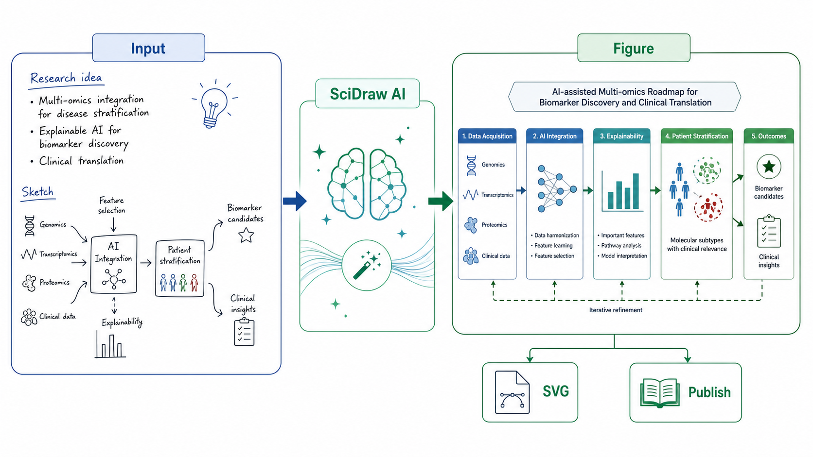
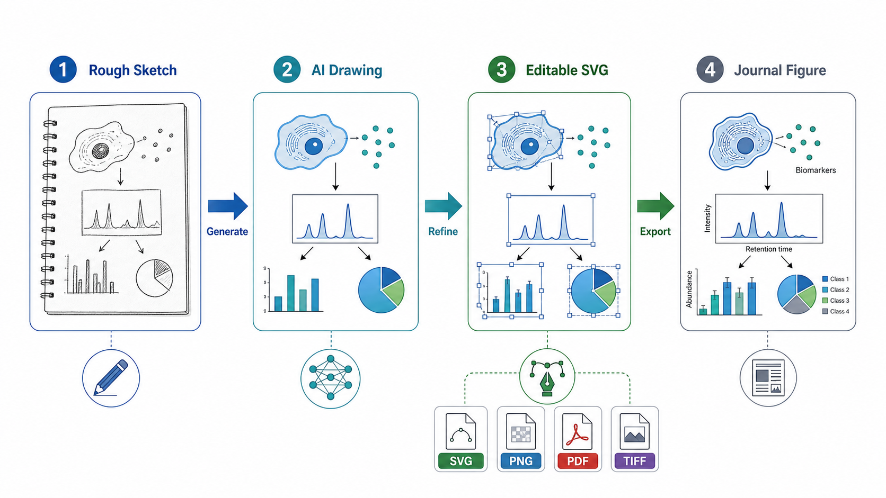
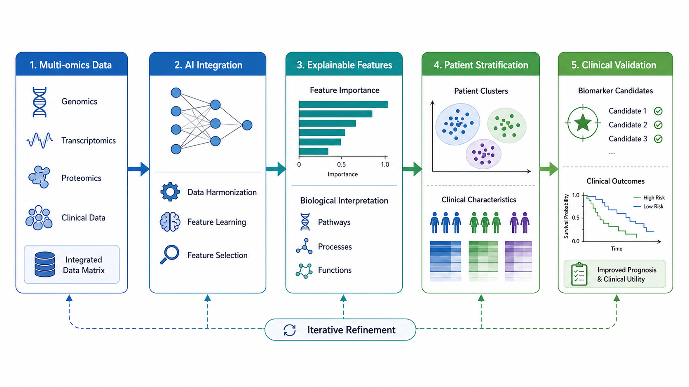
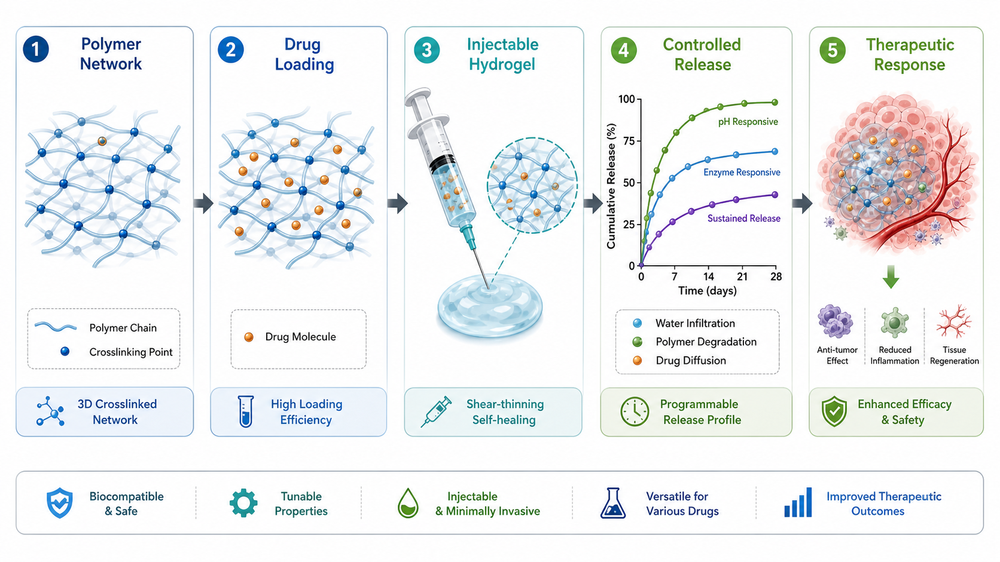
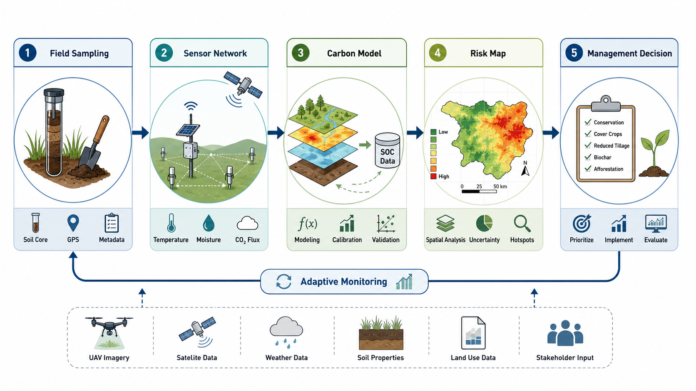

# SciDraw AI 科学研究作図 Skill

[](./README.md)
[](./README_en.md)
[](https://sci-draw.com/ja/ai-drawing)
[](https://github.com/TopLocalAI/scidraw-ai-scientific-illustration-skill/stargazers)
[](https://github.com/TopLocalAI/scidraw-ai-scientific-illustration-skill/forks)

SciDraw AI 公式の科学研究作図 Skill です。Codex、Claude Code、OpenClaw、Hermes Agent など、`SKILL.md` に対応した各種エージェントで利用できます。研究アイデア、論文の手法、研究助成金の技術ロードマップ、実験フロー、モデル構造を明快な科学図版へと変換し、SciDraw AI 公式 API の呼び出しにも対応しています。

> [!TIP]
> ブラウザから直接 [SciDraw AI](https://sci-draw.com/ja/ai-drawing) Web 版を利用することも、公式 API を設定して同梱の Python クライアントから生成することもできます。
>
> - [AI Drawing メインページ](https://sci-draw.com/ja/ai-drawing)
> - [SciDraw AI 公式サイト](https://sci-draw.com/ja)
> - [API Key の作成](https://sci-draw.com/settings/api-keys)
> - [API ドキュメント](https://sci-draw.com/ja/docs/api)
> - [画像を SVG/PPTX/PDF/TIFF などに変換するツール](https://sci-draw.com/ja/convert)
>
> SciDraw AI プラットフォームは、AI Drawing、ラフスケッチから本格的な科学図版への変換、画像編集、編集可能な SVG / PPTX エクスポート、論文投稿品質の PNG / PDF / TIFF エクスポートなどの機能を提供しています。本 skill はエージェント内での科学図版生成およびプロンプト整理のフローをカバーします。

## ご案内

本リポジトリは SciDraw AI の公式エージェント向けエントリポイントです。まずは [SciDraw AI MCP サービス](https://sci-draw.com/ja/mcp) への接続を推奨します。SciDraw AI アカウントでログインするだけで API Key は不要であり、Skill が MCP ツールを検出するとそのまま作図に使用します。MCP がない環境でも、`SCIDRAW_API_KEY` を設定すれば、Skill が科学図版の構成を計画し、SciDraw AI 公式 API を呼び出して結果をダウンロードし、確認と改善のイテレーションを案内します。事前の断りなく別の画像生成サービスへ勝手に切り替えることはありません。

インタラクティブな編集、SVG / PPTX 変換、バッチワークフロー、または出版フォーマットでの書き出しが必要な場合は、フル機能の SciDraw AI Web 版をご利用ください。

## 特徴

- 1 枚ずつの反復改善：デフォルトでは科学図版 1 枚単位でプロンプトと出力を構成するため、構造・スタイル・ラベルを確認しやすく、複数枚必要な場合も 1 枚ずつ順番に生成できます。
- MCP 優先：SciDraw AI MCP サービスに接続済みの場合は API Key 不要で直接呼び出します（Claude Code：`claude mcp add --transport http scidraw-ai https://sci-draw.com/api/mcp`、Codex：`codex mcp add scidraw-ai --url https://sci-draw.com/api/mcp`）。
- API フォールバック：API を直接呼び出す場合は、`SCIDRAW_API_KEY` と Python 標準ライブラリのみに依存する同梱クライアントを使用します。
- Web 版の代替手段：MCP も API key もない場合は、SciDraw AI のオンライン作図機能を利用できます。
- バックエンドの混同を防止：ユーザーが明示的に指定した場合に限り、他の画像生成サービスを使用します。
- 研究用途に最適化：技術ロードマップ図、メカニズム模式図、手法フロー図、モデル構造図、研究フレームワーク図、グラフィカルアブストラクトのドラフト作成に適しています。
- 元画像の制約維持：実験図、スクリーンショット、座標軸、論文の元図を提示した場合、重要なラベル、数値、単位、構造関係を保持するよう指定できます。
- プラットフォームとの補完連携：編集可能な SVG / PPTX 出力、論文投稿品質の PNG / PDF / TIFF 出力、複数回の編集、完全なプロジェクト管理が必要な場合は、SciDraw AI Web サイトの利用を推奨します。

## 生成例

### 研究アイデアから科学研究図へ

[](https://sci-draw.com/ja/ai-drawing)

### 科学研究図のサンプル

| 英語ラベルのワークフロー図 | 英語ラベルのバイオマーカー探索ロードマップ |
| --- | --- |
| [](https://sci-draw.com/ja/ai-drawing) | [](https://sci-draw.com/ja/ai-drawing) |

| ハイドロゲル薬物送達メカニズム図 | 土壌炭素モニタリングワークフロー |
| --- | --- |
| [](https://sci-draw.com/ja/ai-drawing) | [](https://sci-draw.com/ja/ai-drawing) |

## 主な利用シーン

- 国家自然科学基金、社会科学基金、各種研究課題申請における技術ロードマップ図および研究フレームワーク図
- 論文の graphical abstract、TOC graphic、メカニズム模式図、手法フロー図
- 学位論文、口頭試問・公聴会、講義・ゼミ発表における研究プロセス説明図
- AI モデル構造、データ処理 pipeline、システムアーキテクチャ、実験計画図
- ラフな研究アイデアを引き続き編集可能なビジュアル初稿へと整理する作業

## 出力構成

デフォルトでは確認や修正を行いやすいよう、科学図版 1 枚ごとに画像ファイルを出力します。

```text
{出力ディレクトリ}/
└── figure_YYYYMMDD_HHMMSS.png
```

ユーザーが出力パスを指定した場合、skill は指定されたパスを優先します。README 内のサンプル画像は以下に配置されています。

```text
assets/examples/
├── imagegen-demo-scidraw-workflow.png
├── english-sketch-to-export.png
├── english-biomarker-workflow.png
├── english-hydrogel-delivery.png
└── english-soil-carbon-monitoring.png
```

## インストール

### ワンフレーズでインストール

次の文をそのままお使いのエージェントに送信してください。

```text
この SciDraw AI 科学研究作図 skill をインストールしてください：https://github.com/TopLocalAI/scidraw-ai-scientific-illustration-skill
```

### Codex への手動インストール

```bash
npx -y skills@latest add TopLocalAI/scidraw-ai-scientific-illustration-skill \
  --skill scidraw-ai-scientific-illustration \
  --agent codex \
  --global
```

GitHub CLI の Agent Skills コマンドでもインストールできます。

```bash
gh skill install TopLocalAI/scidraw-ai-scientific-illustration-skill \
  scidraw-ai-scientific-illustration \
  --agent codex \
  --scope user
```

インストール完了後、新しい skill を有効にするため Codex を再起動してください。

## SciDraw AI API

> [!TIP]
> API を直接呼び出すと SciDraw AI のクレジットを消費します。Skill は生成を開始する前に解像度と画像枚数を提示して確認を求めます。

[SciDraw AI API Keys](https://sci-draw.com/settings/api-keys) でキーを作成し、ローカルの環境変数にのみ保存してください。

```bash
export SCIDRAW_API_KEY='sd_YOUR_KEY'
```

クライアントは Python 3 標準ライブラリのみを使用し、`POST /api/v1/images/generations` の呼び出し、ジョブのポーリング、および生成結果のダウンロードを行います。詳細な手順については [API ドキュメント](https://sci-draw.com/ja/docs/api) および `skills/scidraw-ai-scientific-illustration/SKILL.md` を参照してください。実際の API キーをチャット、リポジトリ、または公開 Skill パッケージに貼り付けないでください。

## 使い方

Codex、Claude Code、OpenClaw、または Hermes Agent で本 skill の使用を明示的に指定します。例：

```text
scidraw-ai-scientific-illustration skill を使用して、SciDraw AI で 16:9 の研究課題申請向け技術ロードマップ図を生成してください。
```

プロンプトには以下の情報を含めることを推奨します。

1. 図の用途：論文図版、研究助成金申請図、発表・試問用図版、講義資料図、モデル構造図
2. アスペクト比：16:9、4:3、1:1、または学術誌指定のサイズ
3. 論理構成の軸：課題、手法、データ、検証、アウトプット
4. テキスト言語：中国語、英語、または中国語中心＋英語専門用語の併記
5. ビジュアルスタイル：白背景、アカデミックな配色、低彩度、明確な矢印、モジュール階層化
6. 保持すべき制約：維持したいラベル、座標軸、凡例、単位、ロゴ、または元図の内容

プロンプト例：

```text
scidraw-ai-scientific-illustration skill を使用して、SciDraw AI で科学研究の技術ロードマップ図を生成してください。
比率：16:9 横長。
テーマ：マルチオミクスデータに基づく疾患サブタイプ分類とバイオマーカー探索。
構成：データ収集 -> AI 統合モデリング -> 説明可能性解析 -> 患者層別化 -> 臨床検証。
スタイル：白背景、ブルーグリーンのアカデミック配色、明確なモジュール区分と矢印の向き。
テキスト：中国語を中心に、Multi-omics や Biomarker など必要な英語専門用語を保持。
```

## 使いこなしのコツ

- 「科学図を描いて」とだけ書くのではなく、モジュール構成、矢印の関係、最終アウトプットを具体的に記述してください。
- 中国語ラベルの図では文字密度を抑え、論文要旨の段落をそのまま図内に詰め込まないようにしてください。
- 研究助成金・課題申請用の図では、「科学的問い、研究内容、技術ルート、検証ループ」を優先して記述してください。
- 論文の graphical abstract では、「主要な発見、重要メカニズム、手法、応用シーン」を優先して記述してください。
- ラベル、座標軸、実験図に対して厳密な維持要件がある場合は、「これらの内容は必ず保持し、書き換えや差し替えを行わないこと」と明記してください。

## SciDraw AI プラットフォームとの関係

本 skill は [SciDraw AI](https://sci-draw.com/ja/ai-drawing) ワークフローをエージェントエコシステムから利用するための軽量な入り口であり、SciDraw AI プラットフォーム本体がフル機能のプロダクトです。

以下の機能は SciDraw AI プラットフォーム側で提供されています。

- [AI Drawing オンライン生成](https://sci-draw.com/ja/ai-drawing)
- ラフスケッチから本格的な科学図版への変換
- 画像アップロード後の継続編集
- 画像から編集可能な SVG への変換
- 画像から編集可能なテキストレイヤー付き PPTX への変換
- PNG、PDF、TIFF などの出版品質エクスポート
- 論文、研究助成金申請、ポスター、講義資料向けの包括的なワークフロー

## FAQ

- API key がなくても使えますか？  
  使えます。[SciDraw AI MCP サービス](https://sci-draw.com/ja/mcp) に接続してアカウントでログインすれば、Skill が自動的に MCP ツールを使用します。API key が必要なのは同梱の Python クライアントを使う場合のみであり、どちらもない場合でも SciDraw AI Web 版を利用できます。
- この skill で SVG を生成できますか？  
  この skill 自体は画像を出力します。編集可能な SVG / PPTX エクスポートが必要な場合は、SciDraw AI プラットフォームの変換ツールをご利用ください。
- 複数の図を生成できますか？  
  可能ですが、各図の構造、ラベル、スタイルの一貫性を保ちやすくするため、1 枚ずつ順番に生成することを推奨します。一括変換、編集可能なエクスポート、完全なプロジェクト管理が必要な場合は、SciDraw AI プラットフォームの利用を推奨します。
- 生成した図をそのまま学術誌に投稿できますか？  
  科学的正確性、ラベル、単位、および投稿規定のフォーマットについて著者自身の確認が必要です。SciDraw AI プラットフォームでは、本番入稿向けのより充実したエクスポートおよび変換フローを提供しています。

## SciDraw AI の関連リンク

科学研究作図のフル機能は [SciDraw AI](https://sci-draw.com/ja/ai-drawing) で利用できます。

- [AI Drawing](https://sci-draw.com/ja/ai-drawing)
- [公式サイト](https://sci-draw.com/ja)
- [変換ツール](https://sci-draw.com/ja/convert)

## ライセンス

MIT
